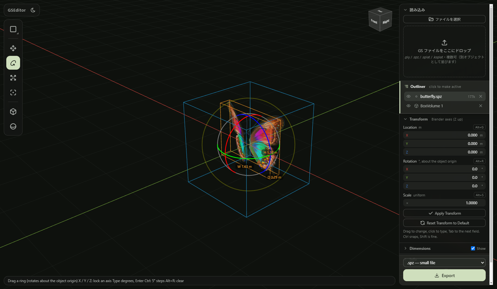

# GSEditor

**写真から作った 3D シーン（ガウシアンスプラッティング、GS）をブラウザで開いて、使える状態に直して保存するツールです。**
ゴミを消し、**シーン全体の原点と向きを手で直し**、その結果をファイルに焼き込んで書き出します。
直したファイルは [GSLayouter](https://github.com/takumanakata/gs-layouter)（カメラを置いてレイアウトを切るアプリ）や、ほかのビューアでそのまま開けます。

**インストールは要りません。ブラウザで開くだけ：** https://takumanakata.github.io/gs-editor/

ファイルはブラウザの中だけで処理され、どこにも送られません（サーバーはありません）。



## 3分でわかる使い方

1. 上のリンクを **Chrome か Edge** で開く
2. **GS ファイル**（.ply / .spz / .splat / .ksplat）を画面にドロップ（右の「ファイルを選択」でも）
3. **見る**：中ドラッグで回転、Shift＋中ドラッグで移動、ホイールで前後。右上のキューブの面をクリックで Top / Front / Right
4. **消す**：左の Select ツールで左ドラッグして粒を選び（W で 箱／丸／投げ縄）、**X** で削除。部屋の中が見えないときは左の箱／球ボタンで Clip Volume を置く
5. **原点と向き**：**O** でスキャン上の原点にしたい点をクリック → **Alt+G** で世界原点へ → **R** で回して水平に（Blender と同じ `R` `Z` `90` ⏎ も可）
6. 右下の **Export**。消した粒と原点・向きを焼き込んだファイルが保存されます（.spz が軽い）

## 何を直すツールか

撮影したままの GS ファイルは、だいたいこうなっています。

- 原点がどこか分からない場所にある（撮り始めたカメラの位置が原点）
- 全体が傾いている、上下が逆になっている
- 空中にゴミ（ノイズ）が浮いている

GSEditor はこれを直して、直した状態のファイルとして保存するためのものです。自動では直しません。
原点マーカーと床のグリッドは動かず、**スキャンのほうを動かして**合わせます（Blender でオブジェクトを動かすのと同じ感覚）。

| やりたいこと | できること |
|---|---|
| 開く | `.ply` / `.spz` / `.splat` / `.ksplat` をドラッグ＆ドロップ |
| 掃除する | 箱・丸・投げ縄で選んで削除（Blender と同じ操作） |
| 原点と向きを直す | 移動・回転・スケール（ハンドル、数値、G / R / S のキー操作）。メートルに合わせる |
| 戻る | 編集履歴パネル。どの手順にでもクリックで戻れる（Ctrl+Z / Ctrl+Shift+Z） |
| 書き出す | 消去と原点・向きの修正を焼き込んだ GS（`.ply` / `.spz` / `.splat`） |

## 使いかた（操作は Blender と同じ）

画面は全面が 3D ビューで、その上に UI が浮いています：左にツール、右にパネル（読み込み／Transform／Dimensions／Info／編集履歴／Export）、下に操作のヒント、右上にビューキューブ。
パネルの見出しをクリックすると折りたためます。表示は英語（読み込みと編集履歴だけ日本語）。

### 開く
右の「ファイルを選択」か、GS ファイルを画面のどこかにドラッグ＆ドロップ（`Ctrl+O` でも）。

### ビューを動かす
| 操作 | |
|---|---|
| 中ドラッグ | 回転（選択があればその中心、なければカーソルの下の面を中心に） |
| Shift＋中ドラッグ | 平行移動 |
| ホイール／Ctrl＋中ドラッグ | 前後 |
| 右上のキューブ | 面をクリックで Top / Front / Right…（自動で平行投影に。Top では床グリッドが濃く、Front / Side では縦のグリッドと高さの軸が出ます）。ドラッグで回転 |
| テンキー 1 / 3 / 7（Ctrl で反対側）、5 | 前／右／上、透視⇔平行投影。テンキーが無ければ上段の 1 / 3 / 7 / 5 |
| Home | 全体を表示 |
| ダブルクリック | その場所へ寄る |

### 掃除する（選んで消す）
左の **Select** ツール（`W` で 箱 → 丸 → 投げ縄 と切り替え。ボタンを押したまま右にスワイプすると一覧が出ます）で左ドラッグして粒を選びます。選んだ粒はオレンジ。
何も押さずにドラッグすると前の選択は消えて新しい選択になります。Shift で追加、Ctrl で除外、`A` で全選択、`Alt+A` で解除、`Ctrl+I` で反転。丸は Shift＋ホイール（または `[` `]`）で大きさを変えます。
**X** か **Delete**、または右クリック → Delete Selected で消えます。`Ctrl+Z` で戻せます。何もない所をクリックすると、粒の選択も Outliner の選択も外れます。

### 見える範囲を絞る（Clip Volume）
部屋のスキャンの中が見えないときなど、左の **箱・球のボタン** で **Box Volume / Sphere Volume** を置くと（原点に 2m 角で現れます）、その**外側（または内側）の粒が非表示**になります。
非表示の粒は選べません。いらない粒を消すときの下ごしらえに便利です。**書き出しには影響しません**（消した粒だけが除かれ、範囲外の粒はそのまま入ります）。
- Clip Volume パネルで Name、Show（Inside / Outside）、Center / Size（Radius）を変えられます。見出し右の Show ☑ で輪郭の表示。`G` / `S` のギズモでも動かせます
- 青い輪郭が範囲。選んでいる間だけ中が半透明の青で塗られます
- 複数置けて、全部の条件を満たす粒だけが残ります。Outliner の目のアイコンで一時的に無効にできます

### 複数のオブジェクトと Outliner
ファイルは何枚でも読み込め、それぞれ別のオブジェクト（自分の原点と向きを持つ）として読み込みの下の **Outliner** に並びます（常に表示・スクロールしても上に残ります）。クリックで active にすると
Transform・Dimensions・Info がそのオブジェクトのものになり、G / R / S もそれに掛かります。目のアイコンで表示・非表示、× で削除。
Info の **Replace File…** で、原点と向きを保ったまま中身のファイルだけ差し替えられます（掃除し直したスキャンに入れ替えるとき）。

### 原点と向きを直す（手作業・Blender のオブジェクトと同じ考え方）
スキャンは1つのオブジェクトで、**自分の原点（オレンジの点）**を持っています。回転と拡縮はこの原点を中心に起きます。
世界の原点（白い点と赤・緑の軸、床グリッド）は動きません。ここに合わせるのが目的です。

1. **Origin（O）** ツールで、スキャン上の原点にしたい場所をクリック（右クリック → Set Origin Here でも）。ハンドルをドラッグすると原点だけ動きます
2. **Alt+G** で、その原点が世界の原点に乗ります（Transform パネルの Location が 0 に）
3. **Rotate（R）** で原点を中心に回して水平に。**Move（G）／Scale（S）** も同様。Blender と同じく `R` → `Z` → `90` → Enter の数値操作、`Ctrl` で刻み（10cm / 5°）。`Alt+R` で回転をクリア、`Alt+S` で大きさをクリア
4. 右の Transform パネルは **Blender と同じ Z-up の値**。ドラッグで変える・クリックで打つ（`Shift` で微調整、`Ctrl` で刻み、`Tab` で次の欄）
5. **Apply Transform（Ctrl+A）** で、今の位置・向きを新しい 0 にできます。書き出される結果は変わらず、以後の微調整がここからの相対値になります。**Reset Transform to Default** で読み込んだ状態に戻ります

ブラウザは何も記憶しません。読み直し・リロードのたびに、ファイルそのままの状態から始まります。自動で水平にする・原点を探すといった自動機能はありません。

### Dimensions / Info
**Dimensions** は active なオブジェクトの、外れた粒を除いた本体のおよその幅・奥行・高さ。見出し右の Show ☑ で 3D ビューに箱と寸法を描きます。Dimensions・Info・History は最初は閉じています（見出しクリックで開く）。
**Info** はファイル名・形式・容量・粒の数と、ブラウザで扱える目安（100 万粒までは快適、300 万を超えると重い）。

### 書き出す
右下の **Export**。保存先と名前を聞く画面が出て（Chrome / Edge。ほかのブラウザではダウンロード）、表示中のオブジェクト全部を1つのファイルにまとめ、
消した粒を除き、原点・向き・大きさの修正を**焼き込んで**保存します（Clip Volume で隠した粒は入ります）。
元のファイルをブラウザの中で読み直して書き直すので、元の精度と視点依存の色（SH）はそのまま残ります。

- **`.spz`（既定）**：いちばん軽い（.ply の 1/3 ほど）。GSLayouter で開けます
- `.ply`：いちばん汎用
- `.splat`：基本色だけの軽い形式（視点依存の色は落ちます）

## 開発者向け

```
_dev/web/     Vite + TypeScript + three.js + Spark(@sparkjsdev/spark) + @playcanvas/splat-transform
docs/         README の画像
起動.bat      ローカルで開発サーバーを立てる（Node.js が要る）。公開版はブラウザで開くだけ
```

```bash
npm --prefix _dev/web install
npm --prefix _dev/web run dev        # 開発サーバー（既定 5173）
npm --prefix _dev/web test           # vitest
npm --prefix _dev/web run typecheck  # tsc --noEmit
```

- `01_Assets/`（git 管理外）に GS ファイルを置くと、開発サーバーで `?gs=<ファイル名>` で直接開けます
- **公開**: `master` に push すると GitHub Actions（`.github/workflows/pages.yml`）がビルドして GitHub Pages に出します
- 書き出し（焼き込み）の仕組み: 画面上の変換は `SceneFrame.root` に掛かっている。`SplatScene.FILE_FLIP`（OpenCV Y-down → Y-up の
  180° 反転）はビューアの都合なので書き出し時には外す。元ファイルを `@playcanvas/splat-transform` で読み直し、消した行を落とし、
  位置・回転・スケール・SH を変換して書く（読み直せない場合は表示データから書く＝基本色のみ）
- `viewer/startFrame.ts` は GSLayouter と同一ファイル（最初の画を揃えるため）。片方だけ変えないこと

ライセンス: MIT（表示側 Spark / three.js、書き出し側 @playcanvas/splat-transform もすべて MIT）。
